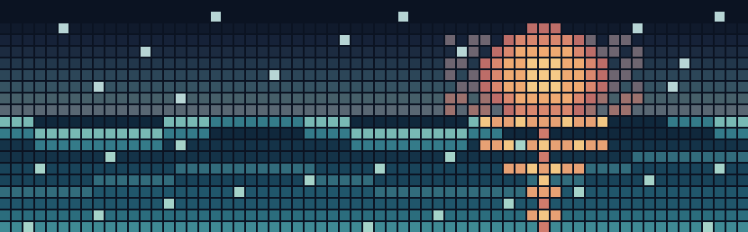

<!-- Profile README for github.com/Felpsqzzy -->
<h1 align="center">Felipe Vieira</h1>

  <strong>Full-stack developer</strong> · Web apps, dashboards & operational tools

  Build fast, refine with care.

---

## Sobre / About

Desenvolvo aplicações web para deixar rotinas operacionais mais claras: da interface e dos dashboards à modelagem de dados e aos controles de acesso. Gosto de prototipar rápido, validar o fluxo e dar acabamento no que realmente ajuda quem usa.

I build practical web apps for operations, connecting useful interfaces, clear data models, and reliable workflows.

## Stack em uso

**HTML** · **JavaScript** · **TypeScript** · **PostgreSQL / PLpgSQL** · **Supabase** · **Vercel**

## Projetos em destaque

| Projeto | O que tem |
| --- | --- |
| [Maintenance Suite · V3](https://v3-manuten-o.vercel.app) · [source](https://github.com/Felpsqzzy/V3---MANUTEN-O) | Gestão operacional, dashboards e controle de acesso |
| [Maintenance Suite · V2](https://v2-manut.vercel.app) · [source](https://github.com/Felpsqzzy/V2-MANUT) | Evolução da aplicação e dos fluxos de manutenção |
| [Maintenance Suite · V1](https://maunbiotrop.vercel.app) · [source](https://github.com/Felpsqzzy/V1-Manuten-o) | Primeira versão pública do produto |

## Dashboard público

| Métrica | Resultado observado |
| --- | --- |
| Linguagens por bytes | HTML **71,83%** · JavaScript **13,71%** · PL/pgSQL **11,40%** · TypeScript **2,19%** · CSS **0,83%** |
| Pico de horário dos commits | **10:00–10:59 BRT** · 50 de 259 commits analisados |
| Projetos na amostra | 3 repositórios públicos: V1, V2 e V3 |

Snapshot consultado em 29/10/2026. A distribuição usa bytes detectados pelo GitHub nos três repositórios. O horário usa os timestamps de autoria dos commits entre 26/08 e 18/09/2026, convertidos para BRT; commit time é apenas uma aproximação e não indica uma sessão de trabalho. Linguagem por bytes também não mede proficiência.

## Contribution snake

A animação é gerada diariamente pelo GitHub Actions e publicada na branch `output`. Para gerar na hora, abra **Actions → Generate profile visuals → Run workflow**. O workflow usa o token automático do GitHub, sem segredo adicional.

  

## Mural em pixels

  

Mural visual original: uma paleta de blue hour, luz quente e maré em blocos de pixel.

## No repeat 🎧

[**“butterflies.” — Brent Faiyaz**](https://open.spotify.com/track/4jyyma8YdFC4S4llusSFRu) · ouvir no Spotify

---

  <a href="https://github.com/Felpsqzzy">GitHub</a>
  &nbsp;·&nbsp;
  <a href="https://v3-manuten-o.vercel.app">Live app</a>

